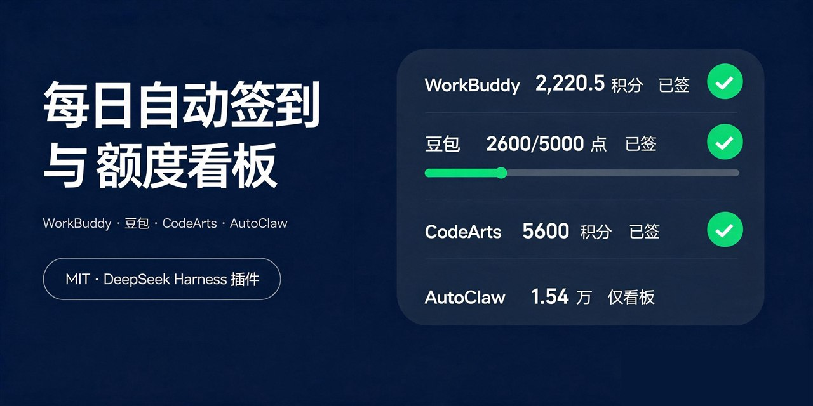
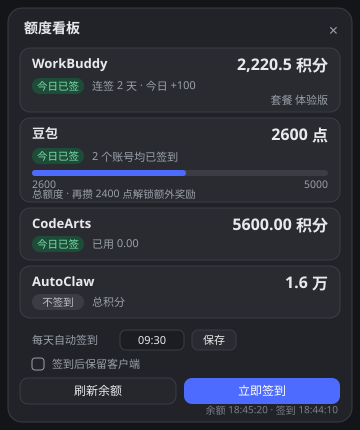

# Credit board · 每日自动签到 + 额度看板



[](https://dsh-plugin.org/plugins/l-da-da/credit-board)

把 WorkBuddy、豆包、CodeArts（以及 AutoClaw 的余额）的签到和积分汇总到 **DeepSeek Harness** 侧边栏的一个面板里，并每天自动签到。

> Windows 10/11 · 需要 Node.js 22+ · 需要已登录 WorkBuddy / 豆包客户端

## 效果

侧边栏底部出现「💰 额度」，点开：



```text
WorkBuddy   2,220.5 积分   套餐 体验版        今日已签
            连签 2 天 · 今日 +100

豆包         2600 点       总额度
            ███████░░░░░  2600 / 5000        今日已签
            用户400177: ok；ldda: ok

AutoClaw    1.6 万        总积分

[ 刷新余额 ]  [ 立即签到 ]
□ 签到后保留客户端
```

- **自动签到**：默认每天 09:30，面板里可改时间（改完立即生效）；窗口最小化、不抢焦点
- **豆包多账号**：自动切换账号逐个签到，签完切回你原来的账号
- **账号校验**：配置 `expectedAccounts` 后，看板显示 WorkBuddy / CodeArts 当前登录账号，登错账号标红提醒（见下文「账号校验」）
- **刷新余额**：后台最小化启动客户端读一次余额（约 2–3 分钟）
- **保留进程**：勾选后签到结束不关客户端，下次直接连上（省去冷启动）

## 安装

```powershell
# 获取仓库，并把插件注册进 DeepSeek Harness（Web profile；桌面版同样适用）
git clone https://github.com/l-da-da/credit-board
dsh plugin --profile web add ./credit-board/plugin
```

或者用一键脚本（把脚本复制到安装目录并注册全部计划任务）：

```powershell
powershell -NoProfile -ExecutionPolicy Bypass -File .\install.ps1
```

签到调度：`DSH-DailyCheckin` 每 15 分钟醒一次，脚本读 `config.json` 的 `checkinTime`（默认 09:30，面板里可改）决定是否执行；**当天成功签到后会自动停掉轮询**，第二天 00:05 由 `DSH-CheckinReset` 重新启用。手动签到走 `DSH-CheckinNow`（带 -Force，跳过时间闸门）。

脚本会：

1. 把程序复制到 `%LOCALAPPDATA%\credit-board`（可用 `-Target` 改）
2. 注册五个计划任务：`DSH-DailyCheckin`、`DSH-CheckinReset`、`DSH-CheckinNow`、`DSH-CreditBoard`、`DSH-CreditCollect`
3. 打印把插件加进 DSH 的那一步

然后：DSH → 设置 → Plugins → **Add plugin** → 选择 `<安装目录>\plugin`，刷新页面。

## 账号校验（可选）

CodeArts 和 WorkBuddy 是单账号应用，客户端里登错账号的话，签到和余额都会读错对象。在 `auto-checkin/config.json` 里加上期望账号：

```json
{
  "keepOpen": false,
  "checkinTime": "09:30",
  "expectedAccounts": { "workbuddy": "你的昵称", "codearts": "账号名或邮箱" }
}
```

之后每次「刷新余额」会顺便读出当前登录账号显示在看板上；**与期望值不一致时整行标红并提示 ⚠ 与期望账号不符**。不配置 `expectedAccounts` 时只显示账号、不做比对。账号名是从头像菜单文本里启发式读取的，应用改版可能导致读不到（此时只显示余额、不比对）。

也可以调服务接口设置：`POST http://127.0.0.1:47122/config`，body 带 `{"expectedAccounts": {...}}`。

## 手动操作

```powershell
# 立刻签到一次（等同面板「立即签到」）
powershell -NoProfile -ExecutionPolicy Bypass -File .\auto-checkin\run-checkin.ps1 -Force
# 立刻采集余额（等同面板「刷新余额」）
powershell -NoProfile -ExecutionPolicy Bypass -File .\auto-checkin\collect.ps1
# 重启看板服务（会先清残留 node，避免 47122 被占）
powershell -NoProfile -ExecutionPolicy Bypass -File .\auto-checkin\install-board.ps1
```

## 工作原理

| 应用 | 签到方式 | 余额 |
| --- | --- | --- |
| WorkBuddy | 启动客户端，它自己领取 | 点头像面板读「积分余额」 |
| 豆包 | 界面上点：账号 → 免费用豆包工作 → 每日签到 | 读页面上的「累计获得额度」（总额度） |
| CodeArts | 点左下角账号头像 → 活动福利 → 每日签到 | 头像菜单里「积分用量 x / y」的 y |
| AutoClaw | 不参与 | 点右上角积分读「总积分」 |

签到和采集都通过 **CDP（Chrome DevTools Protocol）** 在应用内部操作：不修改应用文件、不读取密码、不上传任何数据。看板服务只监听 `127.0.0.1:47122`。

## 目录结构

```
credit-board/
├─ install.ps1 / uninstall.ps1  # 一键安装 / 卸载
├─ auto-checkin/            # 签到 + 采集 + 看板服务
│  ├─ run-checkin.ps1       # 签到入口（启动→签到→按配置关闭/保留）
│  ├─ checkin.mjs           # 签到逻辑（豆包多账号）
│  ├─ collect.ps1 / .mjs    # 余额采集（顺带读当前登录账号）
│  ├─ collect-now.ps1       # 每分钟 tick：发现 refresh.flag 就采集
│  ├─ checkin-now.ps1       # 每分钟 tick：发现 force.flag 就签到
│  ├─ hidden-tick.vbs       # wscript 隐藏启动器（任务动作，无窗口闪烁）
│  ├─ board-service.ps1     # 看板服务的 powershell 桥（wscript→powershell→node）
│  ├─ board-server.mjs      # 看板数据服务 127.0.0.1:47122（只写 flag，不 spawn）
│  ├─ cdp.mjs               # CDP 连接的小封装
│  ├─ enable-checkin.ps1    # 恢复轮询任务（Reset 任务调用）
│  ├─ config.json           # { keepOpen, checkinTime, expectedAccounts? }（不进仓库）
│  ├─ install-task.ps1      # 注册 3 个签到任务
│  └─ install-board.ps1     # 注册看板服务 + 采集任务
├─ plugin/                  # DSH 插件（@local/credit-board）
├─ docs/board.svg           # README 示意图
└─ SKILL.md                 # 给 agent 用的安装说明
```

## 权限与兼容性

- **兼容性**：Windows 10/11；DeepSeek Harness 桌面版 / Web 版（插件注入 `@deepseek-ai/dsh-client-ui-sidebar`）；任务侧需要 Node.js 22+（`install.ps1` 会自动检测）。
- **权限**：插件前端只请求本机 `http://127.0.0.1:47122`；不联网、不读剪贴板、不持久化任何数据。
- **外部服务**：无。余额与签到全部通过 CDP 读取本机客户端界面，不上传任何数据。
- **许可证**：MIT（见 LICENSE）。

## 已知限制

- **额度是封闭的**：三家的签到积分只能在自己的客户端里花，没有 API 可以转换，所以看板只是「把客户端里的数字搬到 DSH 里」。
- **必须启动客户端**才能签到（最小化，不抢焦点）；电脑关机当天签不了，登录后补跑。
- WorkBuddy 的积分要点头像面板才读得到；豆包显示的是「累计获得额度」，剩余额度在「设置 → 订阅与额度管理」。
- 界面改版可能导致点击失效，届时需要更新选择器。
- 自动化操作客户端界面属于个人使用，可能受各家服务条款约束，风险自担；本项目不收集任何数据。

## 卸载

```powershell
schtasks /delete /tn DSH-DailyCheckin /f
schtasks /delete /tn DSH-CheckinReset /f
schtasks /delete /tn DSH-CheckinNow /f
schtasks /delete /tn DSH-CreditBoard /f
schtasks /delete /tn DSH-CreditCollect /f
# 或一键卸载：powershell -NoProfile -ExecutionPolicy Bypass -File .\uninstall.ps1 [-RemoveFiles]
# 再从 DSH 的 Plugins 里移除 @local/credit-board，然后删除安装目录
```

## License

MIT